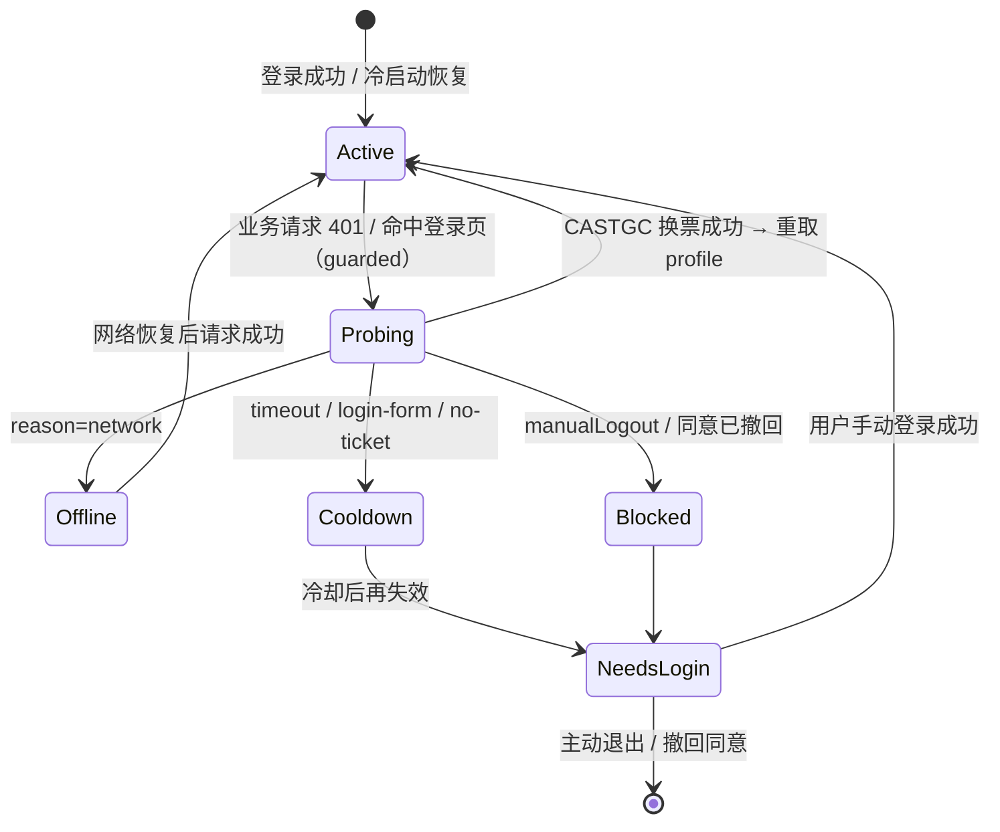
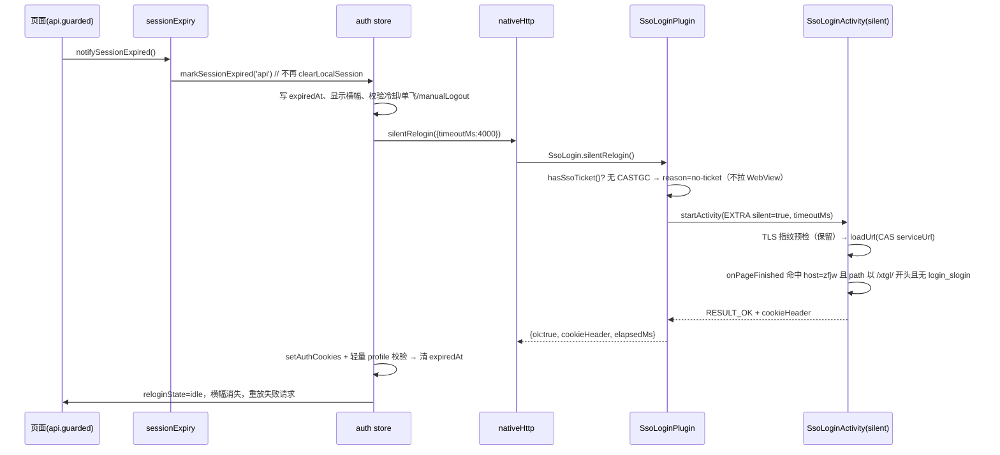

# 登录态保持（静默重登与失效降级）设计

- 日期：2026-11-09
- 版本目标：v2.2.0（当前 2.1.1 / versionCode 32）
- 状态：**部分实现**（P0 静默重登与「失效不清空」已落地；P1 前台补保活、P2 可观测与 SessionBanner 未做，详见 §13）
- 关联：[2026-11-02-session-keepalive-design.md](2026-11-02-session-keepalive-design.md)（本案是它的下一级兜底）、[2026-11-24-keep-alive-design.md](2026-11-24-keep-alive-design.md)（保活现状权威版）、[../plan/方案.md](../plan/方案.md) 会话策略章节、[../../README.md](../../README.md)「关键约束」

## 0. 摘要

现有客户端只在做两件事：维持教务会话（保活）、失效后清空数据回登录页。中间少了最关键的一级——**会话失效时先尝试用统一认证票据（CASTGC）静默换票**。

本方案把 `expireSession()` 从「失效即清空」改造成「失效先续期、续不成才降级」的状态机，交付四件事：

1. **P0 静默重登**：CASTGC 仍在时无界面换票，用户无感。
2. **P0 失效不清空**：只标记失效并显示横幅，缓存与快照保留。
3. **P1 前台补保活**：回到前台且距上次检查超过 25 分钟时补一次。
4. **P2 可观测与引导**：设置页显示上次保活结果；首次开启时引导电池白名单。

改动规模：19 个源文件 + 3 个测试文件，不动网络策略与证书固定。

## 1. 背景

用户的核心疑问是「为什么不能一直保持登录」。答案不在客户端：学校统一认证页没有「记住登录」选项，CASTGC 有效期由学校控制，应用只保留、不重写（见 `SsoCookieCleaner.java` 注释）。

登录态实际由**两层会话**决定：

| 层 | 谁签发 | 寿命 | 决定什么 |
|---|---|---|---|
| 教务业务会话（zfjw） | 正方教务系统 | 空闲约 2–3 小时 | 多久要重登一次 |
| 统一认证 CASTGC | 学校 SSO | 由学校控制，通常更长 | 重登要不要输密码 |

关键事实：**现有的 30 分钟保活只续 zfjw 会话，完全不碰 CASTGC。** 因此当夜间闹钟被系统压制、zfjw 会话次晨已销毁时，本可以靠 CASTGC 静默换票，但当前实现直接 `clearLocalSession()` + 跳登录页，把一次「1–3 秒的后台动作」变成了「用户手动点登录 + 数据全丢」。

## 2. 目标与非目标

**重新定义**：「保持登录」= 在①不保存账号密码 ②不自签或伪造凭据 ③不延长学校票据有效期 三条前提下，把「需要用户手动重新登录」的次数压到最低，并把不可避免的失效做成**可解释的一次点击**，而不是数据全丢的被踢。

三级承诺（对用户如实表述）：

| 情况 | 行为 | 用户感受 |
|---|---|---|
| 会话可续期（CASTGC 在） | 静默换票，不弹任何界面 | 无感 |
| 只能人工登录 | 保留缓存，顶部横幅说明原因 | 被打断但不丢数据 |
| 彻底不可续期（CASTGC 过期 / 主动退出 / 撤回同意） | 明确回登录页 | 正常预期 |

**目标**

1. 会话失效先尝试静默恢复，成功则不打断当前页面与数据。
2. 静默失败时保留只读缓存，用户可见原因并可一键重登。
3. 用户主动退出登录、撤回隐私同意后，任何情况下不得自动重登。
4. 保活结果可观测（上次时间、上次结果、下次时间）。
5. 现有安全策略不削弱：HTTPS 强制、主机白名单、证书指纹固定全部保留在静默分支内。

**非目标**

- 不追求「永不掉线」（CASTGC 有效期由学校控制，做不到）。
- 不做后台弹出登录界面的「自动登录」。
- 不引入代理服务器托管会话。
- 不保存账号密码，不做表单模拟提交。
- 不改动通知、组件、课表变更等其他子系统。

## 3. 现状分析

现有四级兜底阶梯：

| 级 | 机制 | 现状 | 缺口 |
|---|---|---|---|
| L1 | 教务会话活跃 | 有 | — |
| L2 | 后台保活（30 分钟闹钟 + 轻量请求） | 有，但 App 回前台不补，结果不可见 | 深睡 3–6 小时后被 ROM 延迟，静默掉线 |
| L3 | **静默重登（CASTGC 换票）** | **完全缺失** | 直接摔到 L4 |
| L4 | 人工登录 | 有，但 `expireSession()` 顺带 `clearLocalSession()` | 「被踢 + 快照/缓存/附件全清」双重惩罚 |

正交一档：网络失败（`error.network`）已正确处理——不清凭据、保留快照。**不要把它误并入失效判定。**

结论：缺口 = ①无静默重登 ②失效即清空 ③前台不补保活 ④保活结果不可见。

## 4. 总体方案

### 4.1 状态机



### 4.2 静默重登时序



### 4.3 与既有逻辑的衔接

- `src/api/index.js` 的 `guarded()` 保持唯一业务出口不动，仅把 `notifySessionExpired()` 的接收方语义从「立即清理」改为「标记 + 尝试续期」。
- `sessionExpiry.js` 保持单例 handler，通知时补充 `source`（`api` / `restore`）。
- 既有 `expiringPromise` 与新增的 `reloginPromise`、`markingPromise` 合并为一个 `sessionTask`，保证同一时刻只有一个会话任务在跑。

## 5. 接口契约

### 5.1 `src/api/nativeHttp.js`（新增导出）

```ts
type SilentReason = 'ok' | 'no-ticket' | 'timeout' | 'login-form' | 'cert'
                  | 'network' | 'blocked' | 'keystore' | 'no-cookie'

silentRelogin(opts?: { timeoutMs?: number }): Promise<{
  ok: boolean
  reason: SilentReason
  cookieHeader?: string
  finalUrl?: string
  elapsedMs?: number
}>

hasSsoTicket(): Promise<{ hasTicket: boolean }>   // 只读探测，不回传票据值

getKeepAliveState(): Promise<{
  enabled: boolean
  active: boolean
  intervalMinutes: number
  lastCheckAt: number | null
  lastResult: 'ALIVE' | 'EXPIRED' | 'FAILED' | null
  nextCheckAt: number | null
}>

getSessionFlags(): Promise<{ manualLogout: boolean }>
setSessionFlags(f: { manualLogout: boolean }): Promise<{ manualLogout: boolean }>
```

### 5.2 `src/stores/auth.js`（重构后对外方法）

```ts
markSessionExpired(source: 'api' | 'restore'): Promise<void>          // 只标记，不清数据
reloginSilently(force?: boolean): Promise<{ ok: boolean; reason: SilentReason }>  // 单飞
clearSessionAndLeave(reason: 'logout' | 'revoke' | 'user-clear'): Promise<void>
maybeForegroundKeepAlive(now?: number): Promise<void>                 // >25 分钟才触发

reloginState: Ref<'idle' | 'running' | 'failed' | 'offline'>
sessionExpiredAt: Ref<number | null>
```

### 5.3 Capacitor `SsoLogin` 插件（新增方法）

| 方法 | 入参 | 返回 |
|---|---|---|
| `silentRelogin` | `{ timeoutMs?: number }` | 同 5.1 |
| `hasSsoTicket` | 无 | `{ hasTicket: boolean }` |
| `getSessionFlags` | 无 | `{ manualLogout: boolean }` |
| `setSessionFlags` | `{ manualLogout: boolean }` | 同上 |

静默流程走**独立的** `@ActivityCallback handleSilentResult`，不得复用 `handleLoginResult` 的「登录已取消」语义；失败不弹任何对话框。

**Intent extra**

- 请求侧：`silent`(boolean)、`timeoutMs`(int)
- 返回侧：成功 `RESULT_OK` + `cookieHeader`、`finalUrl`；失败 `RESULT_CANCELED` + `reason`

`SsoLoginActivity` 静默分支要求：无状态文案、无重试/证书 AlertDialog、`Theme.SsoSilent`（translucent + noAnimation）、`noHistory`；超时到点直接 `cancel()`。

### 5.4 存储键

| 存储 | 键 | 语义 |
|---|---|---|
| SP `jiaowu_keepalive` | `enabled`（已有）、`lastCheckAt`、`lastResult`、`nextCheckAt` | 保活可观测 |
| SP `jiaowu_sso` | `manual_logout`（新增）、`cookie_cleanup_v3`（已有） | 禁止自动重登的权威标记 |
| localStorage | `jiaowu.session.pendingFailures`（已有）、`jiaowu.session.expiredAt`、`jiaowu.session.silentCooldownUntil`、`jiaowu.session.manualLogout`（镜像，供首屏判断） | 前端状态 |

> `manual_logout` 的权威副本必须在原生 SharedPreferences，localStorage 只做镜像——清除 WebView 数据或前端存储异常时不能把「禁止自动重登」弄丢。

### 5.5 失败原因与处理

| reason | 触发 | 处理 |
|---|---|---|
| `ok` | 换票成功 | 清 `expiredAt`、冷却、横幅消失、重放请求 |
| `no-ticket` | 无 CASTGC | 直接进 `NeedsLogin`，不拉起 WebView |
| `login-form` | 命中 `login_slogin` / `yhm` 表单 | 立即销毁，进冷却，回登录页 |
| `timeout` | 超过 `timeoutMs` 未完成 | 进冷却，回登录页 |
| `cert` | TLS 指纹预检失败 | **不冷却重试**，提示「请更新 App」 |
| `network` | 连接失败 / 超时 | 不打冷却、不写 `expiredAt`、不动缓存，走离线横幅 |
| `blocked` | `manualLogout` 或同意已撤回 | 直接回登录页，禁止任何自动尝试 |
| `keystore` | 有存储但解不开 | 跳过静默，沿用 `pendingFailures` ≤ 3 的快照策略 |
| `no-cookie` | 成功但未拿到 cookie | 视为失败，进冷却 |

## 6. 状态流转与边界

| 场景 | 处理 |
|---|---|
| 并发失效 | `markSessionExpired` 与 `reloginSilently` 各自单飞；同一时刻只允许一次静默尝试 |
| 冷却 | 失败写 `silentCooldownUntil = now + 5min`；成功清零。冷却期内再失效直接进 `NeedsLogin` |
| 用户主动点击重登 | `force=true`，不受冷却限制（用户意图优先） |
| 主动退出 | `logout()` 首行写 `manualLogout=true`（先于 `clearSsoSession`，防中断）；静默入口命中即 `blocked` |
| 撤回隐私同意 | 必须同时 `setKeepAlive(false)` + `clearSsoSession()` + `setSessionFlags({manualLogout:true})`；冷启动直接停在登录页 |
| 重新登录成功 | `loginWithSso()` 成功后清 `manualLogout`、冷却、`expiredAt` |
| Keystore 解密失败 | 跳过静默（拉起来也拿不到会话），沿用快照策略 |
| 无 CASTGC | `no-ticket`，不白跑一次页面闪现 |
| 静默中用户切后台 | Activity 不残留（`noHistory`）；超时后自行结束 |
| 静默成功后原请求 | 重放一次；再失败按普通错误处理，不再触发静默 |

## 7. 文件清单

### Android

| # | 路径 | 改动要点 | 预估 |
|---|---|---|---|
| 1 | `android/app/src/main/java/com/lzqlove/jiaowu/SsoLoginActivity.java` | `silent` 分支、超时、`login-form` 判定、静默下禁用对话框；TLS 预检与白名单不动 | +110/−15 |
| 2 | `.../SsoLoginPlugin.java` | 4 个新方法 + `handleSilentResult` + 扩展 `keepAliveState()` | +80 |
| 3 | `.../SsoCookieCleaner.java` | 新增只读 `hasCastgc(CookieManager)`，不返回票据值 | +15 |
| 4 | `android/app/src/main/res/values/themes.xml` | 新增 `Theme.SsoSilent` | +12 |
| 5 | `android/app/src/main/AndroidManifest.xml` | 静默入口声明 `noHistory` / `excludeFromRecents`（现为 136–139 行） | +6 |
| 6 | `.../keepalive/SessionKeepAliveStore.java` | `lastCheckAt` / `lastResult` / `nextCheckAt` 读写 | +35 |
| 7 | `.../keepalive/SessionKeepAliveService.java` | `checkNow` 每条路径回写结果与时间 | +8 |
| 8 | `.../keepalive/SessionKeepAliveScheduler.java` | 暴露下次触发时间 | +10 |

### 前端

| # | 路径 | 改动要点 | 预估 |
|---|---|---|---|
| 9 | `src/api/nativeHttp.js` | 5 个新导出 | +45/−5 |
| 10 | `src/api/zf.js` | 新增 `reloginSilently()`（原生结果 → `setAuthCookies` → 轻量 profile 校验）；`requestText` 判定不动 | +25 |
| 11 | `src/stores/auth.js` | `expireSession` 拆分为 `markSessionExpired` / `clearSessionAndLeave`；新增静默与前台补保活 | +95/−25 |
| 12 | `src/utils/sessionFlags.js`（新增） | `manualLogout` / `expiredAt` / 冷却读写 | ~45 |
| 13 | `src/utils/sessionExpiry.js` | 通知携带 `source` | +12 |
| 14 | `src/components/SessionBanner.vue`（新增） | 「正在自动恢复…」/「离线，数据可能不是最新」/「点击重新登录」 | ~70 |
| 15 | `src/App.vue` | 挂横幅；`appStateChange` 调 `maybeForegroundKeepAlive()`（现有两处监听在 237、282 行） | +30 |
| 16 | `src/views/AccountSettings.vue` | 展示上次保活结果/时间；开关副文案加「自动恢复」（现 121–220 行） | +30 |
| 17 | `src/utils/keepAliveConsent.js` | 增第 5 条「会话失效时尝试静默恢复，失败才回登录页」；`KEEPALIVE_CONSENT_VERSION` → `'2'` | +12 |
| 18 | `src/utils/privacy.js` | 改写第 37 条保留期限表述；`PRIVACY_VERSION` → `'5'`、`PRIVACY_DATE` 同步 | +18 |
| 19 | `README.md` | 「关键约束」补两条：失效保留只读缓存、静默恢复不存密码 | +6 |

> `src/views/Privacy.vue` 是纯渲染器（遍历 `PRIVACY_SECTIONS`），**无需改动**；只改 `privacy.js` 数据源与版本号即可。

### 测试

| # | 路径 | 改动 |
|---|---|---|
| 20 | `tests/silentRelogin.test.js`（新增） | 单飞、冷却、`blocked`、`network`、`no-ticket` 分支，约 150 行 |
| 21 | `tests/authCleanup.test.js` | 断言改为「失效保留、退出才清」 |
| 22 | `tests/sessionExpiry.test.js` | 通知语义（携带 `source`、不再直接清理） |

## 8. 任务分解

| ID | 任务 | 文件 | 依赖 | 优先级 |
|---|---|---|---|---|
| T01 | 原生静默重登通道（Activity silent + Plugin 4 方法 + 主题/清单 + CASTGC 只读探测） | 1–5 | — | P0 |
| T02 | 原生保活可观测（Store/Service/Scheduler 回写结果） | 6–8 | — | P1，可与 T01 并行 |
| T03 | 前端会话状态机（nativeHttp / zf / auth / sessionFlags / sessionExpiry） | 9–13 | T01（契约可先冻结，前端可 mock 并行） | P0 |
| T04 | UI 与文案（Banner / App.vue / AccountSettings / 同意书 / privacy / README） | 14–19 | T03；设置页展示部分另需 T02 | P0（文案部分 P1） |
| T05 | 测试与真机回归 | 20–22 | T03、T04 | P0 |

并行建议：T01 与 T02 同批；T01 契约冻结后 T03 立即开工，原生与前端可先按假数据对接。

## 9. 风险与合规

**隐私承诺冲突（最高风险）**

`src/utils/privacy.js:37` 现写「登录期间保留，退出登录、清除本机个人数据或卸载应用时删除」。改为失效后保留缓存，必须同步改为「会话失效后保留最多 7 天的只读离线缓存，可在设置中立即清除」，并升版本号。同时 `README.md`「关键约束」补齐同一口径。三处口径必须一致，否则属超范围处理。

**学校可能要求二次验证**

CASTGC 有效但账号策略要求短信验证码时，静默流程会停在验证页。必须以 `login-form` 快速失败、超时兜底，绝不能把验证码页推给用户或假装成功。**这一项直接决定 L3 的命中率，建议先实测再定投入。**

**安全策略不可削弱**

主机白名单、HTTPS 强制升级、SHA-256 指纹固定与 `PinnedTrustManager` 预检在静默分支全部保留；失败原因里不得回传任何票据或 Cookie 值。

**ROM 兼容**

小米/华为/OPPO 深睡冻结 `setAndAllowWhileIdle` 属预期行为，L3 正是该场景的兜底。电池白名单文案不得暗示「开了就一定不掉线」。

**瞬闪**

即使 translucent，CAS 1–2 跳仍可能闪一次。靠 `Theme.SsoSilent` + `noAnimation` 缓解，并用 `no-ticket` 预判与冷却减少无谓拉起。

**测试影响**

`tests/authCleanup.test.js` 现断言失效即清 `dataCache` / `portalCache`，重构后必然失败；需先改断言语义，否则易被误判为回归。

## 10. 验收标准

1. 保活正常、CASTGC 有效：停 App 4 小时后回前台，不出现登录页，横幅 3 秒内消失，课表刷新到实时。
2. CASTGC 已过期：失效后只尝试一次静默，然后回登录页；课表快照仍在（只有退出登录才清）。
3. `logout()` 后杀进程冷启动：停在登录页，日志中无静默重登调用。
4. 撤回隐私同意后冷启动：停在登录页，`getKeepAliveState().enabled === false`，`manual_logout === true`。
5. 飞行模式冷启动：显示缓存课表与离线横幅，`expiredAt` 未写、Cookie 未清。
6. 设置中清除 WebView 数据后冷启动：`hasSsoTicket === false`，直接登录页，不闪 WebView。
7. 连续 3 次静默失败：冷却生效，5 分钟内不再拉起；冷却结束后可恢复。
8. 小米真机深睡 6 小时（未开电池白名单）：回前台触发一次补保活，设置页 `lastCheckAt` 更新并显示 `ALIVE` / `EXPIRED`。
9. 静默进行中切后台：Activity 不残留，回前台可重试。
10. 单测：并发 5 次 `markSessionExpired` 只产生 1 次静默重登；`manualLogout` 时为 0 次。

## 11. 待确认事项

| # | 事项 | 建议值 | 说明 |
|---|---|---|---|
| 1 | 失效后缓存保留范围 | 课表/通知保留 7 天只读；成绩、附件、正文图失效即清 | 换取较小合规风险；与现有 30 天快照策略不一致，需确认 |
| 2 | 学校是否普遍触发短信二次验证 | 先实测（清 zfjw Cookie、留 CASTGC 后重登） | 决定 L3 命中率与 P0 投入是否值得 |
| 3 | 静默超时值 | 4 秒 | 弱网易误判，由冷却兜底；6 秒成功率略高但有等待感 |
| 4 | 同意书版本升到 v2 是否强制重新确认 | 不强制，仅设置页提示 | 避免打扰老用户 |
| 5 | 失效横幅是否提供「立即重新登录」按钮 | 提供，且点击不受 5 分钟冷却限制 | 用户意图优先 |
| 6 | 自动恢复成功是否给轻提示 | 不给 | 与现有一次性欢迎提示冲突 |

## 12. 变更历史

| 日期 | 变更 |
|---|---|
| 2026-11-09 | 初稿：现状缺口分析、状态机、接口契约、文件与任务分解、风险与验收 |
| 2026-11-21 | 补充 §13 实现进度：P0 已落地，P1/P2 与只读横幅仍为待办 |
| 2026-11-24 | 真机核查后补 §13：无本地会话时不排保活、设置页显示「已停止，等待重新登录」 |

## 13. 实现进度（2026-11-22）

已落地：

- **P0 静默重登**：`SsoLoginActivity`（silent 透明页、CAS 登录表单探测、`finishSilent` 回传 reason）→ `SsoLoginPlugin.silentRelogin` → `ZfAcademicApi.reloginSilently` → `auth.attemptSilentRelogin()`，失败原因沿用 §5.5 的 `reason` 表；有单飞与冷却（可恢复失败 30 秒，其余 5 分钟）。
- **P0 失效不清空**（分两档）：`network / timeout / bridge / canceled` 只置 `sessionSuspended`，保留登录态、加密会话与已加载数据，主界面底部提示条支持手动重试，回到前台自动重试一次；`no-ticket / login-form / blocked / no-cookie / verify / unsupported` 进入 `sessionExpired` 只读模式（见下一条）。
- **只读快照 + `expiredAt` + 失效横幅**（§4）：票据确认失效时只清凭据（`clearAuthCookies`）与可能含他人材料的附件缓存，保留课表快照与个人缓存，`sessionExpired = true`；主界面顶部 `SessionExpiredBanner` 提供「重新登录」，`api` 层在只读模式下直接拒绝请求（不再用失效 Cookie 打网络、不再各页触发静默换票）；`localStorage` 记 `jiaowu.session.expiredAt`，冷启动 7 天内用快照续上只读界面，超期或登录成功后清除。`loginWithSso` 的清缓存时机挪到登录成功之后，失败/取消不再丢只读数据。
- **静默超时与兜底对齐**：原生 Activity 内等待默认 12 秒（1.5–20 秒可传），计时从 `loadUrl` 开始、不含 TLS 预检；前端兜底 = 原生等待 + 8 秒预检 + 4 秒桥接余量。
- **保活链路**：票据失效但本地仍有会话时保留闹钟链（不再 `cancel`），静默换票成功或重新登录时由 `setAuthCookies` 重新排程；退出登录仍由 `clearAuthCookies` 取消。2026-11-24 补：`scheduleNext` 改为「开关已开 + 本地确有会话」才排程（`shouldSchedule`）。此前开关开着但 Cookie 已被清掉时，每次启动仍会排一次注定失败的检查，触发后立刻自我 `cancel`，设置页却显示一个并不存在的「下次约」；真机复现为 14:48 判失效清 Cookie 后再无闹钟，静默 3 小时 20 分，直到重新打开 App 才又排上一次。现在无会话时直接 `cancel`，设置页显示「上次保活 …（会话已失效）· 已停止，等待重新登录」，重新登录经 `setAuthCookies` 自动续上。2026-11-24 再补：学校侧对连续在线约 3 小时的会话会强制下线，判定 `EXPIRED` 后仍每 30 分钟重试只会拿到同一个失效结果，因此 `SessionKeepAliveStore` 增加 `backoff` 标记，`nextTrigger(now, backoff)` 退避到 `BACKOFF_MS`（3 小时）；`resumeIfEnabled`（重新登录 / 静默重登）与任何非 `EXPIRED` 结果都会立即恢复 30 分钟间隔。接收器在本次结果写回后若为 `EXPIRED` 会重排一次，避免白打一轮。
- **P2 可观测**：`SessionKeepAliveStore` 持久化 `lastCheckAt / lastResult / nextCheckAt`，`checkNow` 统一出口记账，`scheduleNext`/`cancel` 同步 `nextCheckAt`；`getKeepAliveState()` 返回三字段，「我的 → 账号与设备」显示「上次保活 19:13（会话有效）· 下次约 20:07」。仅在明确退出登录的 `clearSession()` 清历史。
- **降级板块补拉**：`App.vue` 的 `appStateChange` 与 `auth.refreshAfterRecovery()` 在回到前台或会话恢复后，对 `portalNoticesOffline` / `messagesOffline` 的板块各补拉一次。真机联调发现：原先回前台只刷课表，通知与消息会一直停在「网络不可用，显示缓存」，直到用户手动下拉。
- 隐私政策升至 v5（§9 口径）：补充只读缓存最多保留 7 天、保活执行时间与结果仅存本机。

未做（保留原设计）：

- P1 前台补保活（距上次检查超过 25 分钟时 `maybeForegroundKeepAlive`）。
- 电池白名单引导整合（现为设置页独立入口）。
- 保活间隔由 30 分钟放宽到约 90 分钟（第三轮评审建议 11）。
- `manualLogout` 在原生 SharedPreferences 的权威副本（退出瞬间迟到的静默成功仍可能回写 Cookie）。
